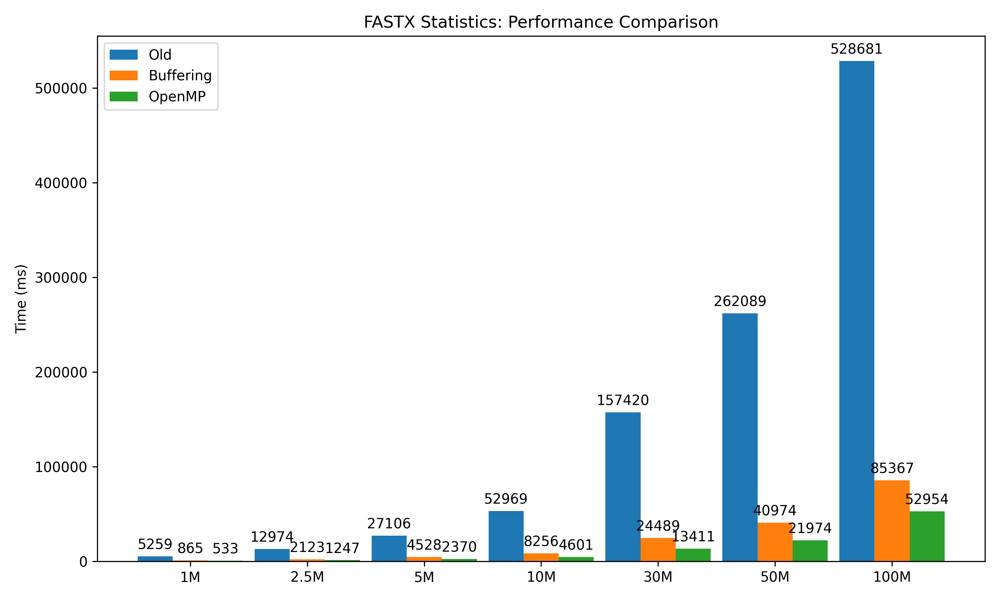

<div align="center">

# ⚡ FASTX-Toolkit


**High-performance FASTQ/FASTA processing toolkit with optimized I/O and parallel processing** 🚀

Based on [agordon/fastx_toolkit](https://github.com/agordon/fastx_toolkit) with significant performance improvements


</div>

---

## ✨ Features

- ⚡ **Block-Based I/O** - Optimized buffered I/O for 80%+ performance improvement
- 🔄 **OpenMP Parallelization** - Multi-threaded processing (requires tuning for optimal performance)
- 🧬 **FASTQ to FASTA Conversion** - Fast and reliable format conversion
- 📊 **Quality Statistics** - Comprehensive sequence quality analysis
- 🎲 **Sample Generator** - Generate test FASTQ/FASTA samples for validation

### Performance Optimization Methods

All tools use **Block-Based I/O** by default. The toolkit provides two performance tiers:

1. **Block-Based I/O** (Default) - Optimized buffering with configurable buffer sizes
2. **OpenMP** - Multi-threaded processing leveraging CPU cores (environment-dependent, requires parameter tuning)

## 📋 Requirements

- 🪟 **Windows 10/11** or 🐧 **Linux** (Ubuntu 20.04+)
- 🔧 **CMake 3.8+** - [Download](https://cmake.org/download/)
- 🔨 **C++17 compatible compiler**
  - Windows: Visual Studio 2019+ with MSBuild
  - Linux: GCC 7+ or Clang 5+
- 🔷 **OpenMP** *(Optional)* - For parallel processing (usually included with compiler)

## 📥 Installation

### Pre-built Binaries *(Coming Soon)*

Pre-compiled binaries will be available in the [Releases](../../releases) page.

### Building from Source

See the [Building from Source](#-building-from-source) section below.

## 📖 Usage

All tools support the `-h` or `--help` flag to display usage information.

### 🔄 FASTQ-TO-FASTA: Convert FASTQ to FASTA

Convert FASTQ files to FASTA format with optional filtering and renaming.

**Options:**

| Option | Description | Default | Range |
|:------:|:------------|:-------:|:-----:|
| `-h` | Print help message | | |
| `-i` | Input file path | STDIN | |
| `-o` | Output file path | STDOUT | |
| `-n` | Keep sequences with unknown (N) nucleotides | false | |
| `-r` | Rename sequence IDs to sequential numbers | false | |
| `--ibufs` | Input buffer size (bytes) | 32768 | ≥ MXSL |
| `--obufs` | Output buffer size (bytes) | 32768 | > 0 |
| `--mxsl` | Maximum sequence length | 25000 | > 0 |

**Example:**

```bash
# Basic conversion
fastq-to-fasta -i input.fastq -o output.fasta

# Convert with filtering and custom buffer
fastq-to-fasta -i input.fastq -o output.fasta -n --ibufs 65536
```

### 📊 FASTX Quality Statistics (Block-Based I/O)

Analyze FASTQ quality scores with optimized buffered I/O.

**Options:**

| Option | Description | Default | Range |
|:------:|:------------|:-------:|:-----:|
| `-h` | Print help message | | |
| `-i` | Input file path | STDIN | |
| `-o` | Output file path | STDOUT | |
| `--bq` | Base quality offset (Phred encoding) | 33 | 0-255 |
| `--mnq` | Minimum quality score | -15 | BQ + MNQ ≥ 0 |
| `--mxq` | Maximum quality score | 93 | BQ + MXQ ≤ 255 |
| `--ibufs` | Input buffer size (bytes) | 32768 | ≥ MXSL |
| `--mxsl` | Maximum sequence length | 25000 | > 0 |

**Example:**

```bash
# Analyze quality with default settings
fastx-qual-stats -i input.fastq -o stats.txt

# Custom buffer and quality range
fastx-qual-stats -i input.fastq -o stats.txt --ibufs 131072 --bq 33
```

### 🔥 FASTX Quality Statistics (OpenMP)

Multi-threaded quality analysis with parallel processing.

> ⚠️ **Performance Warning**: OpenMP performance is **highly dependent on your system environment** and requires careful parameter tuning. Without proper configuration, OpenMP version **may perform slower than the single-threaded Block-Based I/O version**. Test with your specific hardware and dataset before production use.

**Options:**

| Option | Description | Default | Range |
|:------:|:------------|:-------:|:-----:|
| `-h` | Print help message | | |
| `-i` | Input file path | STDIN | |
| `-o` | Output file path | STDOUT | |
| `--bq` | Base quality offset (Phred encoding) | 33 | 0-255 |
| `--mnq` | Minimum quality score | -15 | BQ + MNQ ≥ 0 |
| `--mxq` | Maximum quality score | 93 | BQ + MXQ ≤ 255 |
| `--ibufs` | Input buffer size (bytes) | 32768 | ≥ MXSL |
| `--mxsl` | Maximum sequence length | 25000 | > 0 |
| `--rps` | Record pool size | 500 | > 0 |
| `--ths` | Number of threads | System default | > 0 |
| `--dyn` | Enable dynamic thread scheduling | false | |

**Example:**

```bash
# Use all available cores
fastx-qual-stats-omp -i input.fastq -o stats.txt

# Specify thread count and pool size
fastx-qual-stats-omp -i input.fastq -o stats.txt --ths 8 --rps 1000
```

### 🎲 FASTX Sample Generator

Generate synthetic FASTQ/FASTA samples for testing and validation.

**Options:**

| Option | Description | Default | Range |
|:------:|:------------|:-------:|:-----:|
| `-h` | Print help message | | |
| `-s, --sf` | Sample format (fasta/fastq) | | Required |
| `--nr` | Number of records to generate | | > 0 |
| `--crlf` | Use CRLF line endings | LF | |
| `-o` | Output file path | STDOUT | |
| `--bq` | Base quality offset | 33 | |
| `--mnq` | Minimum quality score | -15 | BQ + \|MNQ\| ≥ 0 |
| `--mxq` | Maximum quality score | 93 | BQ + MXQ ≥ MNQ |
| `--mns` | Minimum sequence length | 1 | > 0 |
| `--mxs` | Maximum sequence length | 50 | ≥ MNS |
| `--obufs` | Output buffer size (bytes) | 32768 | > 0 |

**Example:**

```bash
# Generate 1M FASTQ records
fastx-samp-gen --sf fastq --nr 1000000 -o sample.fastq

# Generate FASTA with custom sequence lengths
fastx-samp-gen --sf fasta --nr 500000 --mns 50 --mxs 200 -o sample.fasta
```

## 💡 Performance Tips

### 1. Start with Block-Based I/O (Recommended)

The Block-Based I/O version provides consistent performance improvements across all environments:

```bash
# Reliable performance with optimized buffering
fastx-qual-stats -i input.fastq -o stats.txt
```

### 2. Optimize Buffer Sizes

I/O performance is fundamentally dependent on disk block size. Experiment with buffer sizes to find optimal values for your hardware:

```bash
# Try different buffer sizes (32KB, 64KB, 128KB)
fastx-qual-stats -i input.fastq --ibufs 32768  # Default
fastx-qual-stats -i input.fastq --ibufs 65536  # 2x larger
fastx-qual-stats -i input.fastq --ibufs 131072 # 4x larger
```

### 3. OpenMP Requires Careful Tuning

> ⚠️ **Critical**: OpenMP performance is **environment-specific** and requires extensive testing. It may perform **worse** than single-threaded version without proper tuning.

**Before using OpenMP in production:**

1. **Benchmark both versions** with your actual data and hardware
2. **Tune thread count** - More threads ≠ better performance
3. **Adjust record pool size** - Balance memory usage and parallelism efficiency
4. **Test different combinations** - Each system has different optimal settings

```bash
# Example: Test OpenMP with conservative settings
fastx-qual-stats-omp -i input.fastq -o stats.txt --ths 4 --rps 500

# Compare performance with Block-Based I/O
fastx-qual-stats -i input.fastq -o stats.txt --ibufs 65536
```

**OpenMP Tuning Parameters:**

```bash
# Smaller files: increase pool size, reduce threads
fastx-qual-stats-omp -i small.fastq --ths 2 --rps 1000

# Larger files: balance threads and pool size
fastx-qual-stats-omp -i large.fastq --ths 8 --rps 300

# Low memory: reduce pool size significantly
fastx-qual-stats-omp -i huge.fastq --ths 4 --rps 100
```

## 🛠️ Building from Source

### Prerequisites

**Windows:**
- Visual Studio 2019 or later
- CMake 3.8+
- Windows SDK

**Linux:**
- GCC 7+ or Clang 5+
- CMake 3.8+
- OpenMP (usually included)

### Build Steps

#### Windows (Visual Studio)

```bash
# Clone the repository
git clone https://github.com/yourusername/fastx-toolkit.git
cd fastx-toolkit

# Configure (uses CMakePresets.json)
cmake --preset=x64-release

# Build
cmake --build out/build/x64-release --config Release

# Executables will be in: out/build/x64-release/fastx-toolkit/
```

#### Linux

```bash
# Clone the repository
git clone https://github.com/yourusername/fastx-toolkit.git
cd fastx-toolkit

# Configure
cmake -B build -DCMAKE_BUILD_TYPE=Release

# Build
cmake --build build --config Release -j$(nproc)

# Install (optional)
sudo cmake --install build
```

### Build Configurations

Available CMake presets (Windows):
- `x64-debug` - 64-bit Debug build
- `x64-release` - 64-bit Release build (recommended)
- `x86-debug` - 32-bit Debug build
- `x86-release` - 32-bit Release build

## 📊 Benchmarks

**Test Environment:**
- Device: ROG Zephyrus G16 (GA403UI-QS091)
- OS: Windows 11
- Method: Minimum of multiple runs, rounded



### FASTX Quality Statistics Performance

| Record Size | Old (ms) | Block-Based I/O (ms) | OpenMP (ms) | Block-Based Speedup | OpenMP Speedup | OpenMP vs Block-Based |
|:-----------:|:--------:|:--------------------:|:-----------:|:-------------------:|:--------------:|:---------------------:|
| 1M          | 5,259    | 865                  | 533         | **83.6%**           | **89.9%**      | +38.4%                |
| 2.5M        | 12,974   | 2,123                | 1,247       | **83.7%**           | **90.4%**      | +41.0%                |
| 5M          | 27,106   | 4,528                | 2,370       | **83.3%**           | **91.2%**      | +47.7%                |
| 10M         | 52,969   | 8,256                | 4,601       | **84.4%**           | **91.3%**      | +44.2%                |
| 30M         | 157,420  | 24,489               | 13,411      | **84.4%**           | **91.5%**      | +45.3%                |
| 50M         | 262,089  | 40,974               | 21,974      | **84.4%**           | **91.6%**      | +46.4%                |
| 100M        | 528,681  | 85,367               | 52,954      | **83.8%**           | **89.9%**      | +38.0%                |

### Key Findings

- ⚡ **Block-Based I/O**: Consistent ~84% performance improvement (6.2x faster) across all dataset sizes
- 🔥 **OpenMP**: Up to 91.6% speedup (12x faster) on large datasets (50M+ records)
- 🎯 **Scaling**: OpenMP provides 38-48% additional improvement over Block-Based I/O
- 🪟 **Windows Performance**: Testing on Windows 11 shows exceptional improvements (up to 12x faster)
- 🐧 **Linux Performance**: On Linux (Ubuntu 24.04), improvements are slightly lower but still significant (3-5x faster)

## 🔧 Technologies Used

| Technology | Purpose | Version |
|------------|---------|---------|
| [C++](https://isocpp.org/) | Core language | 17 |
| [CMake](https://cmake.org/) | Build system | 3.8+ |
| [OpenMP](https://www.openmp.org/) | Parallel processing | 4.5+ |
| [fmt](https://github.com/fmtlib/fmt) | String formatting | Included |
| [args.hxx](https://github.com/Taywee/args) | Argument parsing | Included |

## ⚙️ Implementation Details

### Why Not RAII?

This project **intentionally avoids RAII** (Resource Acquisition Is Initialization) patterns in performance-critical sections. Testing revealed that:

- **Performance Impact**: RAII usage paradoxically caused performance degradation
- **Test Environment**: Windows 11 with Visual Studio MSBuild
- **Cause**: Compiler-specific optimization behaviors and destructor overhead in tight loops
- **Solution**: Manual resource management in hot paths for optimal performance

> ⚠️ **Note**: This is a **Windows + Visual Studio MSBuild specific issue**. Other compilers and platforms may have different characteristics.

### Project Status

- ✅ FASTQ-TO-FASTA - Complete
- ✅ FASTX Statistics (Block-Based I/O) - Complete
- ✅ FASTX Statistics (OpenMP) - Complete
- ✅ FASTX Sample Generator - Complete

## 🐛 Troubleshooting

<details>
<summary><b>❌ Build fails with CMake errors</b></summary>

- ✅ Ensure CMake 3.8+ is installed: `cmake --version`
- ✅ On Windows, run from Visual Studio Developer Command Prompt
- ✅ Delete `out/` or `build/` directory and try again
- ✅ Verify C++17 compiler support

</details>

<details>
<summary><b>⚠️ OpenMP not found</b></summary>

**Windows:**
- OpenMP is included with Visual Studio (2019+)
- Ensure you're using Visual Studio compiler, not MinGW

**Linux:**
- Install: `sudo apt-get install libomp-dev` (Ubuntu/Debian)
- Install: `sudo yum install libomp-devel` (RHEL/CentOS)

</details>

<details>
<summary><b>🐌 Performance slower than expected</b></summary>

- ✅ Ensure Release build configuration is used
- ✅ Try different buffer sizes with `--ibufs` flag
- ✅ **Start with Block-Based I/O version first** - It provides consistent performance
- ✅ If using OpenMP, test if it's actually faster than Block-Based I/O on your system
- ✅ Tune OpenMP parameters (`--ths`, `--rps`) - default values may not be optimal
- ✅ Check available system resources (CPU, RAM, disk I/O)
- ✅ For SSDs, larger buffer sizes (128KB+) may help
- ✅ For HDDs, buffer sizes matching disk block size are optimal

</details>

<details>
<summary><b>💾 Out of memory errors with OpenMP</b></summary>

- ✅ Reduce record pool size: `--rps 200`
- ✅ Reduce thread count: `--ths 4`
- ✅ Use Block-Based I/O version instead for very large files
- ✅ Check system RAM availability

</details>

<details>
<summary><b>📁 Input/output file issues</b></summary>

- ✅ Ensure input file exists and is readable
- ✅ Check output directory has write permissions
- ✅ Verify file format (FASTQ files should have quality scores)
- ✅ Use absolute paths if relative paths fail
- ✅ Check for special characters in file paths

</details>

## 📄 License

This project is licensed under the GNU Affero General Public License v3.0 (AGPL-3.0) - see the [LICENSE.txt](LICENSE.txt) file for details.

### Key License Points

- ✅ Free to use, modify, and distribute
- ✅ Source code must be made available when distributed
- ✅ Modifications must also be licensed under AGPL-3.0
- ⚠️ Network use triggers source code disclosure requirements

## 🙏 Acknowledgments

- [agordon/fastx_toolkit](https://github.com/agordon/fastx_toolkit) - Original FASTX-Toolkit implementation
- [fmtlib/fmt](https://github.com/fmtlib/fmt) - Modern C++ formatting library
- [Taywee/args](https://github.com/Taywee/args) - Argument parsing library

---

